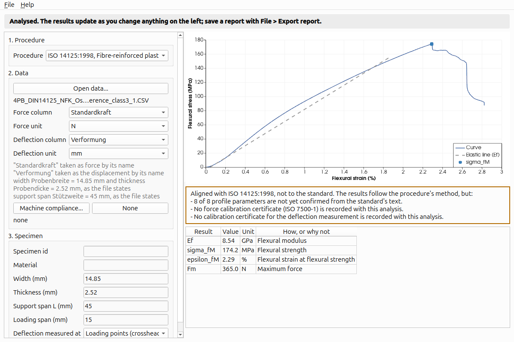

# TenForge

Open universal testing software: tension, compression and bending, for
any universal testing machine.

**Status: release 0.3, tension, compression and bending from any
machine's export, with exports for FreeCAD, CalculiX, ParaView, PyVista
and Platform MaterialDigital.** Choose the procedure, open a CSV, follow the bar at the
top of the window, read the results with the curve, export a PDF or HTML
report, save the test as an open record. Procedures: ISO 6892-1 (metals)
and ISO 527-1 (plastics) in tension, ISO 604 (plastics) and ISO 844 (rigid
foams) in compression, ISO 178 (plastics, three-point) and ISO 14125
(fibre composites, three- and four-point) in bending. Validated against
NPL's TENSTAND dataset, BAM's S355 tests and, for bending, ZwickRoell
testXpert III's own evaluation of TU Braunschweig's four-point tests (see
[Validation](#validation)). The manual: [docs/manual/](docs/manual/).
What comes next: [ROADMAP.md](ROADMAP.md).



## What it is for

- **Any machine.** One driver layer for DIY rigs (Klipper first),
  open-protocol devices and retrofitted frames; or no machine at all, by
  analysing a file another machine wrote.
- **Named standards, honestly reported.** Results computed by the
  procedures of ISO 6892-1, ISO 527, ISO 604, ISO 844, ISO 178, ISO 14125
  and more, each labelled as either to the standard or only aligned with
  it, with calibration class and uncertainty.
- **A pristine record.** Raw counts and device timestamps kept, nothing
  resampled behind your back, provenance with every file.
- **At home in the VTK and FreeCAD ecosystems.** Tests open in ParaView
  and PyVista; material cards and hardening curves export to FreeCAD and
  CalculiX.

## Works alongside, never requires

TenForge interoperates with [SurView](https://github.com/katalystnord/SurView)
(digital image correlation) and [OpenCorr](https://github.com/vincentjzy/OpenCorr)
through open, documented files, and with any other tool that reads or
writes them. None of them is needed to use TenForge, and TenForge is not
needed to use them.

## Building

Linux, Ubuntu 26.04 or later:

```bash
sudo apt install cmake ninja-build g++ qt6-base-dev qt6-base-dev-tools qt6-svg-dev \
    libvtk9-dev libvtk9-qt-dev libgl1-mesa-dev libeigen3-dev xvfb
cmake -S . -B build-ninja -G Ninja
cmake --build build-ninja
tools/run-tests.sh
build-ninja/src/TenForge          # the window
tools/make-appimage.sh            # dist/TenForge-<version>-x86_64.AppImage
```

## Installing

Download the AppImage from the Releases page (x86_64 Linux, built on
Ubuntu 26.04 and needing a distribution about that new), `chmod +x` it
and run it. Or build from source, below.

## Analysing a file

In the window: choose the **Procedure**, then do what the bar at the top
says.
The [manual](docs/manual/) walks through it.

From the command line:

```bash
tf-analyse --list-profiles
tf-analyse --profile iso-6892-1-2019 --area "120.6 mm2" --gauge-length "50 mm" export.csv
tf-analyse --profile iso-527-1-2019 --area "40 mm2" --json results.json export.csv
tf-analyse --profile iso-178-2019 --width "10 mm" --thickness "4 mm" --span "64 mm" export.csv
tf-analyse --profile iso-14125-1998-four-point --loading-span "15 mm" \
           --deflection-at loading-points zwick-export.csv
tf-analyse --profile iso-844-2021 --width "50 mm" --thickness "50 mm" --gauge-length "50 mm" \
           --compliance machine.csv foam.csv
```

Columns are found by name (force, load, Kraft; extensometer, then
extension, deflection, deformation, strain and their German and French
names, then crosshead or position) unless given with `--force` and
`--extension`; width, thickness and span are taken from a file header that
states them (ZwickRoell testXpert writes them); units come from the file's
units row or column names, or `--force-unit` and `--extension-unit`.
Comma, semicolon and tab files with a decimal point or comma are read as
they are. Every result says how it was made, or why it could not be.

**Every result is currently "aligned", not "to the standard".** The
profiles' parameters are entered from public sources and stay marked
unconfirmed until checked against the purchased standards, and calibration
certificates can be recorded only from release 0.6. The results say so, with
each reason.

## Validation

- **NPL TENSTAND** (15 files with agreed values, NPL Report DEPC MPE 015):
  Rp0.2, ReH, ReL, Rm and A for all 15 files within the proof-of-confidence
  limits of EN 10002-1 Annex A.5; Rp0.1, Fm, At, Ag and Agt within
  TenForge's own tighter bands. E falls inside the agreed range for 13 of
  15 files. The data is fetched when the tests run.
- **BAM S355** (10 specimens, raw exports and BAM's evaluated results):
  ReH within 0.7 MPa, Rm within 0.5 MPa and Fm within 0.1 % of BAM's
  values; E within 1 GPa for 9 of 10.

- **TU Braunschweig ISO 14125** (23 four-point bending specimens of hemp
  fibre laminate, raw testXpert III exports and testXpert's printed
  results): Ef, the stresses at both ends of the modulus window, R2,
  sigma_fM and eps_fM all within half a unit of the last digit testXpert
  printed, and the same number of samples in every modulus regression
  (161 comparisons, none failed). The data is fetched when the tests run.

Details: [docs/validation/phase-1.md](docs/validation/phase-1.md) (tension)
and [docs/validation/phase-3.md](docs/validation/phase-3.md) (compression
and bending, with what is not yet validated).

## Built with

[Qt 6](https://www.qt.io/) (LGPL-3.0), [VTK](https://vtk.org/)
(BSD-3-Clause), [Eigen](https://eigen.tuxfamily.org/) (MPL-2.0).

## Data credits

- BAM S355 tensile tests: Schilling, M., Glaubitz, S., Matzak, K.,
  Rehmer, B., Skrotzki, B. (2022), [doi:10.5281/zenodo.6778336](https://doi.org/10.5281/zenodo.6778336),
  CC BY 4.0. Included unchanged in `tests/fixtures/bam-s355/`.
- NPL TENSTAND Premium Quality ASCII datafiles and agreed values: National
  Physical Laboratory, TENSTAND project (EU G6RD-CT-2000-00412), NPL Report
  DEPC MPE 015 (2005). The datafiles are fetched from npl.co.uk when the
  tests run, not included.
- TU Braunschweig four-point bending tests: Osten, A., Steinmetz, J.,
  Charif, S., Voelkerink, O. (2025), [doi:10.5281/zenodo.17611621](https://doi.org/10.5281/zenodo.17611621),
  CC BY 4.0. One export included unchanged in
  `tests/fixtures/braunschweig-14125/`; the rest fetched when the tests run.
- Aged PU foam compression tests: Pires da Silva, E. H. (2023),
  [doi:10.17632/2sp8fyvhfm.3](https://doi.org/10.17632/2sp8fyvhfm.3),
  CC BY 4.0. One test and its dimensions included unchanged in
  `tests/fixtures/puf-d1621/`.
- Instron exports, one per dialect, included unchanged in
  `tests/fixtures/instron/` (sources, licences and MIT notices in its
  `SOURCE.md`): UML Applied Solid Mechanics Lab (LGPL-2.1); Aryan Senthil,
  Javier Linero and henryflushman (MIT); Signorini, C., Nobili, A.,
  Sola, A., Messori, M. (2019), [doi:10.17632/kbg7dz3yhx.3](https://doi.org/10.17632/kbg7dz3yhx.3),
  CC BY 4.0; Hong, C. (2020), [doi:10.6084/m9.figshare.13345313.v1](https://doi.org/10.6084/m9.figshare.13345313.v1),
  CC BY 4.0.

See [NOTICE](NOTICE).

## Licence

LGPL-2.1-or-later. See [LICENSE](LICENSE).
