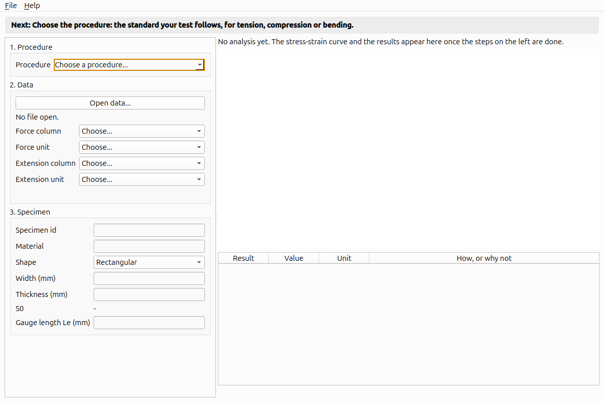
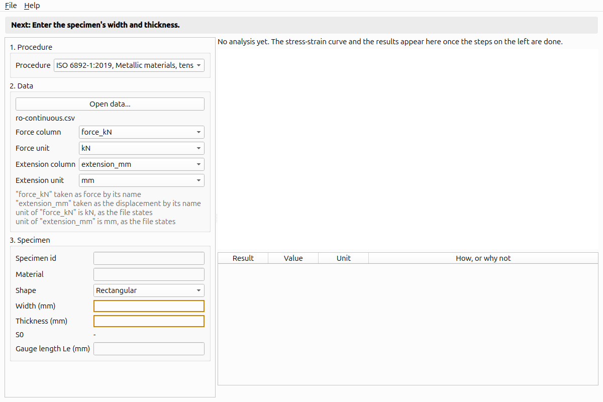
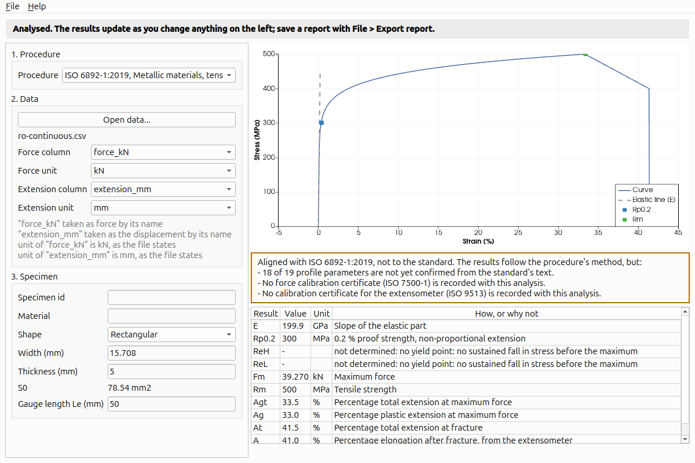
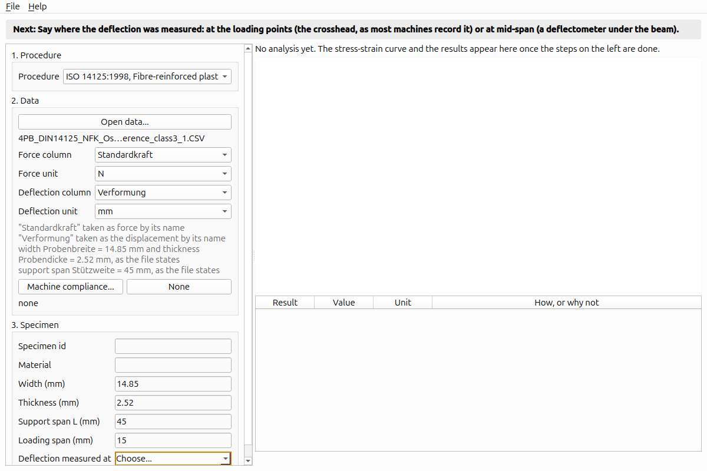
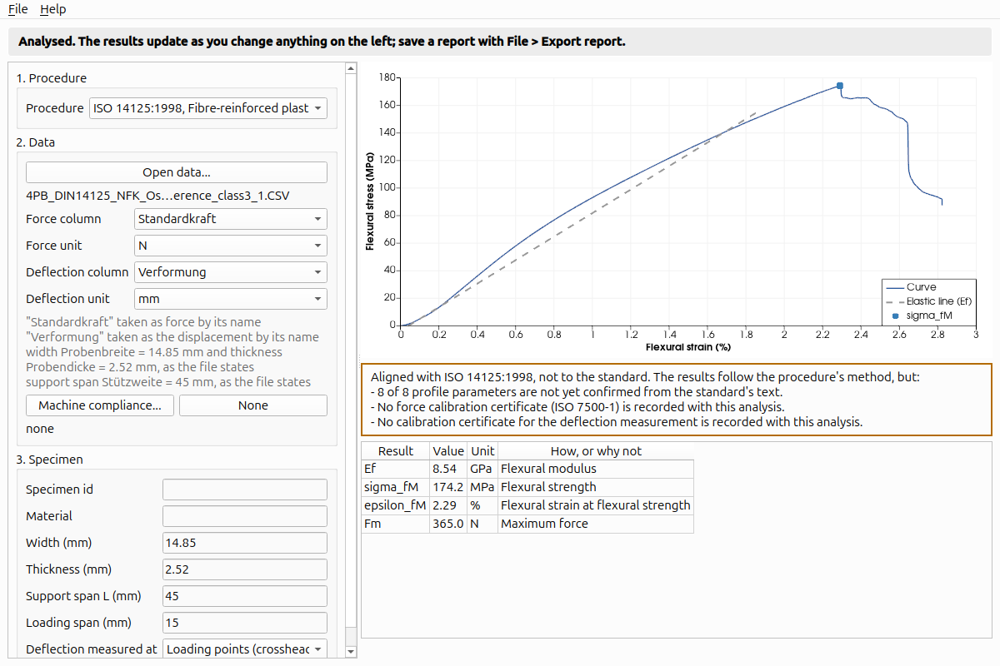

# TenForge manual

For TenForge 0.2. This manual grows with each release; what is not here
yet is listed under [What 0.2 does not do](#what-02-does-not-do).

1. [Installing](#installing)
2. [Analysing a tensile test](#analysing-a-tensile-test)
3. [Bending tests](#bending-tests)
4. [Compression tests](#compression-tests)
5. [Machine compliance](#machine-compliance)
6. [Reading the results](#reading-the-results)
7. [The report](#the-report)
8. [Test records](#test-records)
9. [Without a window: tf-analyse](#without-a-window-tf-analyse)
10. [What 0.2 does not do](#what-02-does-not-do)

## Installing

**The AppImage** (Linux, x86_64): download `TenForge-0.2.0-x86_64.AppImage`
from the project's Releases page, make it executable and run it:

```bash
chmod +x TenForge-0.2.0-x86_64.AppImage
./TenForge-0.2.0-x86_64.AppImage
```

It carries Qt, VTK and everything else it needs, except the C library
and the graphics driver, which come from your system. It is built on
Ubuntu 26.04, so it needs a distribution of about that age or newer; on
an older one it refuses to start with a message naming `GLIBC`.

**From source**: see [Building](../../README.md#building) in the README.

## Analysing a tensile test

TenForge reads the file your testing machine exports: a CSV or text
file of columns, whatever its dialect (comma, semicolon or tab; decimal
point or comma; a block of `key;value` lines above the header; units in a
row of their own or in the column names). Nothing in the file is changed;
TenForge only reads it.

The bar across the top of the window always says the **one next step**,
and the field it is about is outlined. Follow it from top to bottom.



### 1. Procedure

Choose the standard your test follows. It comes first because it decides
what else is asked: a bending test needs a span, a tensile test a gauge
length.

- **ISO 6892-1:2019**, metallic materials in tension: E, Rp0.2, ReH, ReL,
  Fm, Rm, Agt, Ag, At, A.
- **ISO 527-1:2019**, plastics in tension: Et, the stress and strain at
  the maximum and at break.
- **ISO 604:2002**, plastics in compression; **ISO 844:2021**, rigid
  foams in compression (see [Compression tests](#compression-tests)).
- **ISO 178:2019**, plastics in three-point bending; **ISO 14125:1998**,
  fibre composites in three-point (method A) or four-point (method B)
  bending (see [Bending tests](#bending-tests)).

**A profile file...** loads a procedure you wrote yourself in TenForge's
profile format ([docs/specs/profile-v1.md](../specs/profile-v1.md)).
Results from it are labelled as coming from a user profile.

### 2. Data

Press **Open data...** (or **File > Open data**, Ctrl+O) and choose the
file. TenForge finds the force column and the extension, deformation or
deflection column by their names (force, load, Kraft; extensometer first,
then extension, deflection, deformation, Verformung, Durchbiegung,
Déformation and others, then a crosshead or position column), and their
units from the file, and says under the fields how it decided each. If it
cannot tell, for example when a file states no units, the bar asks you to
choose: pick the column or unit from the list.

The extension may be a length (mm, m, in) or a strain (%, mm/mm). A
strain needs no gauge length.



### 3. Specimen

Choose the shape and enter the measured dimensions in millimetres:
rectangular (width and thickness), round (diameter), tube (outer and
inner diameter), or the cross-section S0 directly if that is all you
have. S0 is shown as soon as it can be computed. Then enter the
extensometer gauge length Le.

If the file states S0 (`So`) or Le in its header block, TenForge fills
them in and says so; check them against your specimen.

The specimen id and material are optional; they appear in the report and
the record.

As soon as nothing is missing, TenForge analyses the test. Change
anything on the left and the results follow at once.



## Bending tests

Choose ISO 178 or ISO 14125. The specimen is a rectangular beam, so the
window asks for its **width** and **thickness**, then the **support span
L**. For four-point bending (ISO 14125 method B) it also asks for the
**loading span** (between the two loading points) and **where the
deflection was measured**:

- **Loading points (crosshead)**: the machine's crosshead travel, which
  is what most machines record. The crosshead moves the loading points,
  not the middle of the beam, and the strain is worked out for that.
- **Mid-span (deflectometer)**: a deflection gauge under the middle of
  the beam.

The two give strains about 15 % apart, so TenForge asks rather than
assumes. In three-point bending they are the same place and it does not
ask.



If the file's header states the width, thickness and span (ZwickRoell
testXpert writes Probenbreite, Probendicke and Stützweite), they are
filled in and the notes say so; check them against your specimen.

ISO 178's stress at conventional deflection, sigma_fC, is taken at a
deflection of 1.5 times the thickness, as the standard defines it, which
is 3.5 % strain only when the span is 16 times the thickness. The
procedures also check the fixture: ISO 178 that the span is 15 to 17
times the thickness, ISO 14125 method B that the loading span is a third
of the span. A check not met is shown with the results and is a reason
they are not to the standard.



## Compression tests

Choose ISO 604 (plastics) or ISO 844 (rigid cellular plastics). Enter
the cross-section as for tension, then **L0, the length the deformation
is measured over**: the specimen's height between the platens when the
column is the platens' travel, or the extensometer's gauge length.

Machines often record compression as negative force and travel. TenForge
takes the test's own direction as positive and says so in the notes; the
file and the record keep its signs.

ISO 844 counts deformation from where the steepest straight part of the
curve meets zero force (the toe of a foam curve is left out), and gives
the compressive strength sigma_m only when the curve has a maximum before
10 % deformation; otherwise it says so, and sigma_10, the stress at 10 %,
is the figure to report. ISO 604 gives the compressive yield stress (the
first maximum the stress then falls below) and the compressive strength
(the largest stress).

## Machine compliance

In compression and bending, the crosshead travel includes the machine's
own deflection. **Machine compliance...** under the data takes a table
of force against that deflection, measured without a specimen (a CSV
with a force column and a displacement column, units stated), and
subtracts it from the travel before strain is worked out. The table must
cover the largest force of the test; TenForge never extrapolates it and
says so if it does not. **None** removes it. A record keeps the table
with the test.

## Reading the results

**The orange box comes first.** It says whether the results are *to the
standard* or only *aligned with* it, and why. In 0.2 every result is
aligned, never to the standard, because:

- the profiles' parameters (fit windows, offsets, rounding) were entered
  from public sources and are marked unconfirmed until checked against
  the purchased text of the standard;
- no calibration certificate for the force or extension measurement can
  be recorded yet (that arrives with calibration, release 0.6).

The results follow the standard's method; the label says what has not
been verified, so nobody mistakes them for certified values.

**The table** gives each result rounded as the procedure states, with its
unit. A result that could not be found says why, for example *"no yield
point: no sustained fall in stress before the maximum"*, or that the
extensometer stopped before fracture. TenForge never fills a gap with a
guess.

**The chart** shows stress against strain, the elastic line the modulus
was fitted to, and each strength where it was found on the curve.

**Flags** below the table are things to look at even when everything was
determined, such as a peak that was not treated as a yield point and why.

## The report

**File > Export report** (Ctrl+E) writes a PDF, or an HTML page if you
name the file `.html`. The report holds the conformity statement and its
reasons, the specimen, the chart, every result or the reason it is
missing, any flags, and the provenance: the data file's name and SHA-256,
the procedure's version and SHA-256, and the TenForge version and build.
Anyone holding the same file can check that it is the one analysed.

## Test records

**File > Save record** saves the test as a new folder (a *record*):

```
S355-07/
  manifest.tfrec      every file below, with its SHA-256
  test.json           specimen, fixture, procedure, where each channel came from
  channels/           force and extension (or deformation, or deflection),
                      the file's value beside the SI value
  source/             your file, byte for byte, and any compliance table
  results/            results.json and results.csv
```

The format is open and described in
[docs/specs/test-record-v1.md](../specs/test-record-v1.md); any tool can
read it without TenForge.

**File > Open record** opens a record by its `manifest.tfrec`. TenForge
analyses it again and tells you, above the fields:

- if a file in the record has changed or gone missing since it was saved;
- if a stored result differs from what a fresh analysis gives (for
  instance after the procedure was updated);
- if the folder holds files the manifest does not list, for example a
  script or a DIC analysis you put under `analyses/`. TenForge never
  adopts them silently: **Add them to the record's manifest** records
  them with their hashes, and changes nothing else.

## Without a window: tf-analyse

The same analysis from the command line, for scripts:

```bash
tf-analyse --list-profiles
tf-analyse --profile iso-6892-1-2019 --area "120.6 mm2" --gauge-length "50 mm" export.csv
tf-analyse --profile iso-527-1-2019 --area "40 mm2" --json results.json export.csv
tf-analyse --profile iso-178-2019 --width "10 mm" --thickness "4 mm" --span "64 mm" export.csv
tf-analyse --profile iso-14125-1998-four-point --loading-span "15 mm" \
           --deflection-at loading-points --force-unit N --extension-unit mm zwick.csv
tf-analyse --profile iso-604-2002 --width "10 mm" --thickness "4 mm" \
           --gauge-length "10 mm" --compliance machine.csv export.csv
```

When something is missing, tf-analyse says what, in the window's words,
with the option that supplies it.

`tf-analyse --help` lists every option.

## What 0.2 does not do

- **Files only.** Running a machine arrives in 0.4; until then TenForge
  analyses what another program recorded.
- **One test at a time.** Statistics over a series (mean, standard
  deviation, confidence interval, Weibull) are computed by the engine but
  not yet offered in the window.
- **Aligned, never to the standard**, as explained above.
- **No uncertainty** on the results yet; it arrives with calibration.
- **No large-deflection correction** for three-point bending (ISO 14125
  Annex B), and no specimen classes for ISO 14125.
- **ISO 844's fallback zero** for a curve without a straight part (the
  deformation at 250 Pa) is not implemented; such a curve is refused for
  want of a modulus.
